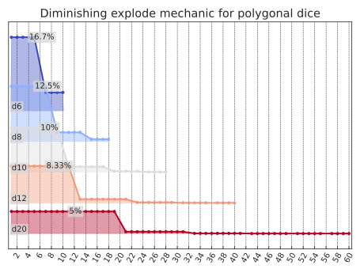

<!---
  Copyright and other protections apply.
  Please see the accompanying LICENSE file for rights and restrictions governing use of this software.
  All rights not expressly waived or licensed are reserved.
  If that file is missing or appears to be modified from its original, then please contact the author before viewing or using this software in any capacity.

  !!!!!!!!!!!!!!!!!!!!!!!!!!!!!!!!!!!!!!!!!!!!!!!!!!!!!!!!!!!!!!!!!!!!
  !!!!!!!!!!!!!!! IMPORTANT: READ THIS BEFORE EDITING! !!!!!!!!!!!!!!!
  !!!!!!!!!!!!!!!!!!!!!!!!!!!!!!!!!!!!!!!!!!!!!!!!!!!!!!!!!!!!!!!!!!!!
  Please keep each sentence on its own unwrapped line.
  It looks like crap in a text editor, but it has no effect on rendering, and it allows much more useful diffs.
  Thank you!
  -->

# Expansion and recursion

## Constructing an exploding dice mechanic

Explosion is a great way to illustrate use of the [`expand` interface][dyce.expand].
One way to approximate an exploding die is to recursively re-roll and add to a running total whenever the outcome is the die’s highest.
This framing is intuitive because it maps to well to how exploding dice are typically handled at the table.

We might start with something like the following:

    >>> from dyce import H, HResult, expand
    >>> def naive_explode(result: HResult[int]) -> H[int] | int:
    ...     if result.outcome == max(result.h):
    ...         # If we've rolled the max for this die, add another die roll
    ...         # to our existing outcome
    ...         return result.outcome + expand(naive_explode, result.h)
    ...     return result.outcome
    >>> d6 = H(6)
    >>> h = expand(naive_explode, d6)
    >>> print(h.format(scaled=True, width=65))
    avg |    4.20
    std |    3.26
      1 |  16.67% |#################################################
      2 |  16.67% |#################################################
      3 |  16.67% |#################################################
      4 |  16.67% |#################################################
      5 |  16.67% |#################################################
      7 |   2.78% |########
      8 |   2.78% |########
      9 |   2.78% |########
     10 |   2.78% |########
     11 |   2.78% |########
     13 |   0.46% |#
     14 |   0.46% |#
     15 |   0.46% |#
     16 |   0.46% |#
     17 |   0.46% |#
     19 |   0.08% |
     ...
     47 |   0.00% |

```linenums="0"
TruncationWarning: expand: some branches with path probability < Fraction(1, 8388607) were truncated
```

What just happened?
It appears that we went no further than eight rolls (a first roll plus up to seven explosions).
Folks familiar with this domain might recognize the distribution looks *mostly* correct, but the counts are a bit…*off*.
With eight rolls, we might also expect to see `48` as the largest outcome, but it’s not present.
The [`TruncationWarning`][dyce.TruncationWarning] provides a clue.

The way to eliminate a branch from consideration when calling [`expand`][dyce.expand] recursively is to explicitly return the empty histogram `H({})` from our callback.
(See the `always_reroll_on_one` example from [`expand`’s docstring][dyce.expand].)
Our callback does not explicitly return `H({})`, but there are two scenarios where that is done implicitly on our behalf.
The first is when a branch’s cumulative path probability falls below `min_path_probability` (which is what happened in our example above).
And the second is when we’ve exhausted the call stack:

    >>> from fractions import Fraction
    >>> fair_coin = H({0: 1, 1: 1})
    >>> expand(
    ...     naive_explode,
    ...     fair_coin,
    ...     min_path_probability=Fraction(0),
    ... )  # these numbers get *big*
    H({0: ..., ...})

```linenums="0"
TruncationWarning: expand: some branches whose recursion depth exceeded 1000 were truncated
```

When either of those things happen, [`expand`][dyce.expand] “truncates” those branches by returning `H({})`.
Let’s take a closer look at our implementation:

```python linenums="6"
       return result.outcome + expand(naive_explode, result.h)
```

For the above line, if [`expand`][dyce.expand] returns `H({})`, our callback will also return `H({})` for that branch.
This is because adding `H({})` to anything is `H({})`:

    >>> H({}) + 1024
    H({})

This explains why `48` is missing from our results above.
A more illustrative case is trying to “explode” a one-sided die (d1), where no branch is “settled” before exhaustion occurs:

    >>> expand(naive_explode, H(1))
    H({})

How do we fix this?
Great question!
Thanks for asking!

It’s easy.
We can check.

    >>> def guarded_explode(result: HResult[int]) -> H[int] | int:
    ...     if result.outcome == max(result.h):
    ...         inner = expand(guarded_explode, result.h)
    ...         if inner:
    ...             # Only return another histogram if we weren't truncated
    ...             # somewhere down the line
    ...             return result.outcome + inner
    ...     # Every other case returns our current outcome
    ...     return result.outcome
    >>> expand(guarded_explode, d6)
    H({..., 19: 1296, ..., 23: 1296, 25: 216, ..., 29: 216, 31: 36, ..., 35: 36, 37: 6, ..., 41: 6, 43: 1, ..., 48: 1})

```linenums="0"
TruncationWarning: expand: some branches with path probability < Fraction(1, 8388607) were truncated
```

*Much* better.

But how can we control the number of explosions?
We *could* do some math and fiddle with [`expand`][dyce.expand]’s `min_path_probability` parameter.

    >>> num_faces = 6
    >>> explosions = 3
    >>> expand(
    ...     guarded_explode,
    ...     H(num_faces),
    ...     min_path_probability=Fraction(1, num_faces ** (explosions + 1)),
    ... )
    H({1: 216, 2: 216, 3: 216, ..., 22: 1, 23: 1, 24: 1})

```linenums="0"
TruncationWarning: expand: some branches with path probability < Fraction(1, 1296) were truncated
```

But that’s fragile and highly domain-specific.
Instead, we can take advantage of [`expand`][dyce.expand]’s ability to pass down arbitrary keyword arguments to make our own depth counter.

    >>> def guarded_explode_n(result: HResult[int], n: int = 0) -> H[int] | int:
    ...     if n > 0 and result.outcome == max(result.h):
    ...         inner = expand(guarded_explode_n, result.h, n=n - 1)
    ...         if inner:
    ...             return result.outcome + inner
    ...     # Every other case returns our current outcome
    ...     return result.outcome

    >>> expand(guarded_explode_n, d6, n=3)
    H({1: 216, 2: 216, 3: 216, ..., 22: 1, 23: 1, 24: 1})
    >>> expand(guarded_explode_n, d6, n=0) == d6
    True

Our callback is still implicitly limited by the `min_path_probability` parameter, but we can make that go away by setting it to `Fraction(0)` as we did in our recursion exhaustion illustration above.
To make that the default, we create a simple wrapper:

    >>> from collections.abc import Callable
    >>> from typing import TypeVar
    >>> T = TypeVar("T")
    >>> def proper_explode_n(
    ...     source: H[T],
    ...     *,
    ...     n: int = 0,
    ...     min_path_probability: Fraction = Fraction(0),
    ... ) -> H[T]:
    ...
    ...     def _callback(result: HResult[T], *, n_left: int) -> H[T] | T:
    ...         if n_left > 0 and result.outcome == max(result.h):  # type: ignore[type-var] # zuban: ignore[arg-type]
    ...             inner = expand(_callback, result.h, n_left=n_left - 1)
    ...             if inner:
    ...                 return result.outcome + inner
    ...         return result.outcome
    ...
    ...     return expand(
    ...         _callback, source, n_left=n, min_path_probability=min_path_probability
    ...     )
    >>> proper_explode_n(d6, n=3)
    H({1: 216, 2: 216, 3: 216, ..., 22: 1, 23: 1, 24: 1})
    >>> proper_explode_n(d6, n=0) == d6
    True

The above is very nearly the implementation for `dyce`’s own [`explode_n`][dyce.explode_n], which includes a `resolver` parameter.
We’ll explore that next.

## Using `dyce.explode_n`

Let’s say we’re considering a new exploding mechanic.
For the first explosion, one must roll the highest outcome on a given die.
A second explosion occurs if either the highest or second highest outcome is rolled.
A third explosion occurs if anything greater than or equal to the third highest outcome is rolled.
Etc.
We’ll never allow explosions if the minimum outcome is rolled.

    >>> from dyce import explode_n
    >>> def explosions_get_easier_resolver(
    ...     result: HResult[T], n_left: int, n_done: int
    ... ) -> H[T] | T:
    ...     return (
    ...         result.h
    ...         # Explode only maximum value if we haven't exploded yet,
    ...         # on [max - 1..max] if we've already exploded once, on
    ...         # [max - 2..max] if we've already exploded twice, etc.
    ...         # ...
    ...         if (
    ...             result.outcome >= max(result.h) - n_done  # type: ignore[operator,type-var] # zuban: ignore[arg-type]
    ...             and
    ...             # ... but never explode on the minimum
    ...             result.outcome > min(result.h)  # type: ignore[operator,type-var] # zuban: ignore[arg-type]
    ...         )
    ...         else result.outcome
    ...     )
    >>> d10 = H(10)
    >>> h = explode_n(
    ...     d10,
    ...     n=3,
    ...     resolver=explosions_get_easier_resolver,
    ... )
    >>> print(h.format(scaled=True, width=65))
    avg |    6.19
    std |    4.71
      1 |  10.00% |##################################################
      2 |  10.00% |##################################################
      3 |  10.00% |##################################################
      4 |  10.00% |##################################################
      5 |  10.00% |##################################################
      6 |  10.00% |##################################################
      7 |  10.00% |##################################################
      8 |  10.00% |##################################################
      9 |  10.00% |##################################################
     11 |   1.00% |#####
     12 |   1.00% |#####
     13 |   1.00% |#####
     14 |   1.00% |#####
     15 |   1.00% |#####
     16 |   1.00% |#####
     17 |   1.00% |#####
     18 |   1.00% |#####
     20 |   0.10% |
     21 |   0.20% |#
     22 |   0.20% |#
     23 |   0.20% |#
     24 |   0.20% |#
     25 |   0.20% |#
     26 |   0.20% |#
     27 |   0.10% |
     28 |   0.01% |
     29 |   0.03% |
     30 |   0.05% |
     31 |   0.06% |
     32 |   0.06% |
     33 |   0.06% |
     34 |   0.06% |
     35 |   0.06% |
     36 |   0.06% |
     37 |   0.06% |
     38 |   0.05% |
     39 |   0.03% |
     40 |   0.01% |

Now let’s consider a “diminishing returns” explosion mechanic, where standard polygonal dice “degrade” into their next smallest die for the next explosion.
We’ll draft our resolver so that it can take a progression of dice in the form of a `dict` mapping the current die to the next one.

    --8<-- "docs-src/plot_matplotlib_diminishing_explode.py:core"

However, [`explode_n`][dyce.explode_n] doesn’t provide a mechanism to pass arbitrary arguments to its *resolver* callback.
`functools.partial` provides a work-around.

    --8<-- "docs-src/plot_matplotlib_diminishing_explode.py:viz"

<!-- Should match any title of the corresponding plot title -->
<picture>
  <source media="(prefers-color-scheme: dark)" srcset="images/plot_matplotlib_diminishing_explode_dark.svg">
  <source media="(prefers-color-scheme: light)" srcset="images/plot_matplotlib_diminishing_explode_light.svg">
  
</picture>

Interactive version: [](https://dycelib.org/latest/jupyter/lab/?path=diminishing_explode.ipynb)

For more complicated mechanics that don’t fit neatly into [`explode_n`][dyce.expand]’s *resolver* parameter, we can always write our own using the more flexible [`expand`][dyce.expand].
